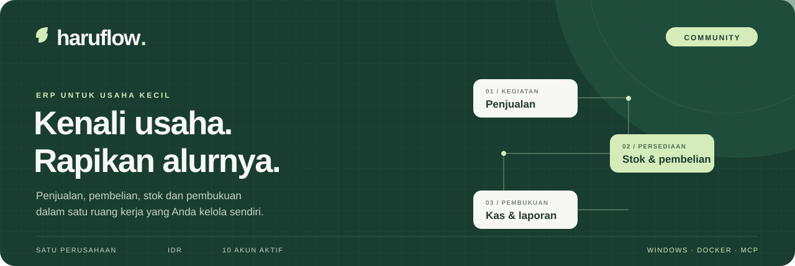
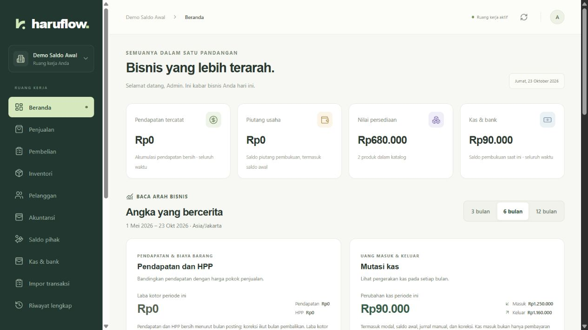
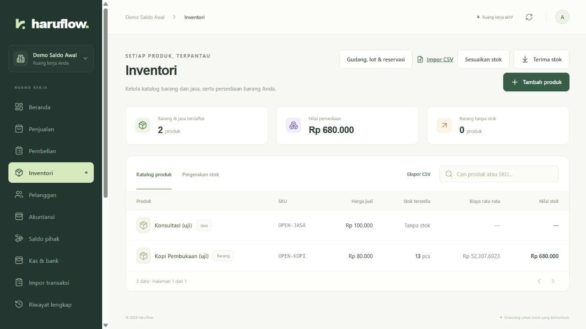
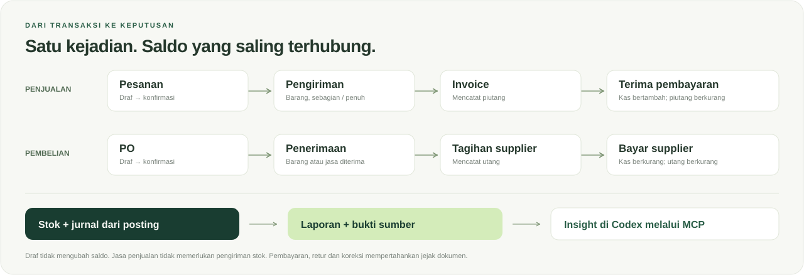
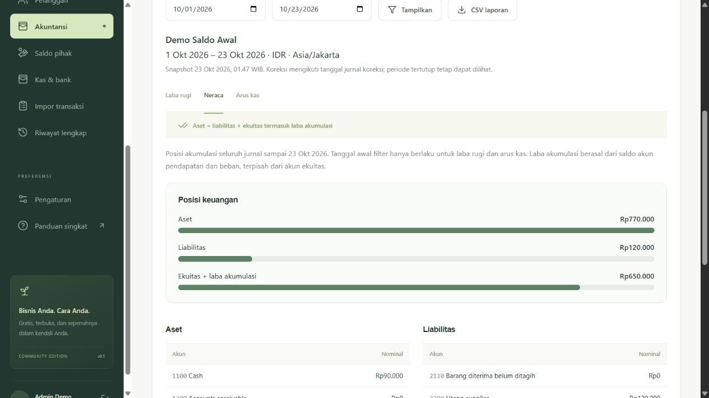
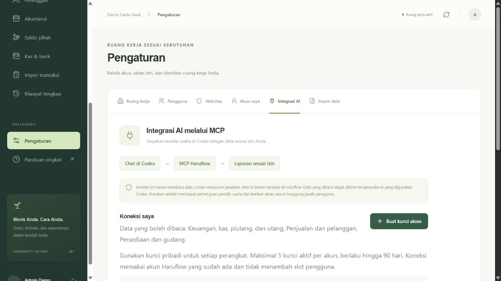

<p align="center"></p>

# Panduan pemakaian Haruflow Community

Untuk satu usaha kecil, satu perusahaan, IDR dan paling banyak 10 akun aktif. Panduan ini mengikuti pekerjaan harian; rincian akuntansi serta pemulihan tersedia pada tautan masing-masing. Gambar di bawah berasal dari aplikasi yang benar-benar berjalan dengan **data simulasi**, bukan rancangan layar atau data bisnis nyata.

[Mulai](#1-mulai-dari-perusahaan-anda) · [Data awal](#2-siapkan-data-dan-saldo-awal) · [Jual dan beli](#3-ikuti-alur-dokumennya) · [Laporan](#4-baca-angka-dengan-konteksnya) · [Codex](#5-minta-insight-melalui-codex) · [Backup](#6-backup-dan-pulihkan) · [Latihan](#7-latihan-sebelum-operasional)

ERP menghubungkan pekerjaan yang biasanya dicatat terpisah. Saat barang dikirim, stok berkurang; saat dibuat invoice, muncul tagihan pelanggan; saat pelanggan membayar, kas bertambah dan sisa tagihan berkurang. Karena peristiwanya berbeda, tombol pengiriman, invoice dan pembayaran juga terpisah.

- **Piutang:** uang yang masih harus dibayar pelanggan kepada usaha.
- **Utang:** uang yang masih harus dibayar usaha kepada supplier.
- **HPP:** biaya barang yang sudah dijual; berbeda dari harga jualnya.
- **Jurnal:** catatan pembukuan dari suatu kejadian. Haruflow membuat jurnal otomatis untuk posting operasional yang relevan.

## 1. Mulai dari perusahaan Anda

Pasang paket Windows mengikuti [panduan instalasi](WINDOWS.md), atau jalankan Docker dari [README](../README.md#mulai). PostgreSQL diperlukan. Buka alamat yang ditampilkan installer; bawaan lokal adalah `http://127.0.0.1:8080`.

Pada instalasi kosong, gunakan kode setup pribadi untuk membuat perusahaan dan administrator pertama. Tidak ada username/password bawaan. Simpan kode dan konfigurasi secara pribadi; jangan memotretnya untuk dokumentasi. Setelah login, periksa nama perusahaan, kontak dan zona waktu di **Pengaturan**. Zona waktu hanya dapat diubah sebelum jurnal pertama.



*Beranda menunjukkan ringkasan dan chart. Nilai pada kartu tetap perlu dibaca sesuai periode serta cakupan laporan.*

Admin membuat pengguna sesuai tugas: Sales, Warehouse, Finance atau Viewer. Satu orang boleh merangkap pekerjaan, tetapi akun bersama menyulitkan penelusuran tindakan. Maksimal 10 akun **aktif**, termasuk admin; menonaktifkan akun mempertahankan riwayatnya. [Pengelolaan pengguna](USER_LIMIT.md).

## 2. Siapkan data dan saldo awal

1. Buat pelanggan, supplier dan produk. Tentukan produk **barang** atau **jasa**, satuan dasar, dan harga. Jenis produk yang sudah dipakai tidak dapat diganti sembarang.
2. Mulai dengan Gudang utama dan Kas 1100. Tambahkan gudang/rekening jika memang dipakai usaha. Lot/seri/expiry hanya diaktifkan pada barang yang memerlukannya.
3. Buka **Akuntansi → Saldo awal**, sebelum transaksi operasional pertama. Masukkan stok beserta biaya, kas/aset/modal, piutang/utang per dokumen serta uang muka/kredit lama yang masih tersisa.
4. Tinjau sampai debit sama dengan kredit. Posting sekali setelah rincian cocok. Pembukaan bukan tombol reset data atau pengganti tutup tahun.
5. Untuk banyak baris, gunakan template CSV dan periksa preview. Impor master tidak menambah stok; impor historis finansial tidak membuat ulang pengiriman barang lama. Hindari mengimpor transaksi yang sudah masuk saldo awal.



*Posisi stok harus dibaca per produk dan satuan. Jangan menjumlahkan pcs dan kg sebagai satu total kuantitas.*

[Saldo awal](OPENING_BALANCES.md) · [Impor master](IMPORTS.md) · [Impor historis](TRANSACTION_IMPORTS.md) · [Gudang, lot dan reservasi](INVENTORY_LOCATIONS.md).

## 3. Ikuti alur dokumennya



**Penjualan:** buka Penjualan, buat pesanan dan konfirmasi. Untuk barang, posting pengiriman sebagian/penuh sesuai stok, lalu buat invoice dari jumlah yang sudah dikirim. Jasa dapat ditagih setelah konfirmasi tanpa pengiriman stok. Catat pembayaran aktual pada rekening yang benar sampai sisa tagihan; pembayaran menurunkan piutang, bukan menambah penjualan untuk kedua kali.

**Pembelian:** buat supplier dan PO, konfirmasi, terima barang/jasa, lalu catat tagihan supplier. Penerimaan barang menambah persediaan; penerimaan jasa tidak menambah stok. Tagihan dan pembayaran merupakan langkah berbeda. Jumlah yang belum diterima/ditagih/dibayar tetap terlihat. Ongkir, diskon, selisih harga dan pajak eksplisit perlu direview sebelum posting.

**Uang muka dan kredit:** catat dana aktual pada **Saldo pihak**, lalu alokasikan ke tagihan pihak yang sama. Dana melebihi invoice tidak dipaksakan sebagai pembayaran langsung; bagian yang belum dipakai tetap terlacak. Alokasi tidak mencatat arus kas lagi. Refund dicatat setelah uang benar-benar berpindah.

**Koreksi:** mulai dari dokumen sumber dan baca dependensinya. Dokumen posted dipertahankan; pembalikan membuat transaksi lawan dengan alasan. Jangan membuat transaksi kedua untuk menutupi kesalahan tanpa memeriksa efek stok, kas dan jurnal. Lampirkan bukti PDF/PNG/JPEG pada dokumen yang sesuai.

[Penjualan bertahap](SALES_FULFILLMENT.md) · [Pembelian](PURCHASING.md) · [Saldo pihak](PARTY_BALANCES.md) · [Retur](RETURNS.md) · [Koreksi](CORRECTIONS_AND_CHARTS.md) · [Lampiran](ATTACHMENTS.md).

## 4. Baca angka dengan konteksnya



Di **Akuntansi → Laporan keuangan**, pilih rentang tanggal dan cocokkan rincian ke transaksi sumber.

- **Laba rugi** menjelaskan pendapatan dan beban selama periode. Kas yang diterima belum tentu pendapatan; modal awal dan uang muka berbeda perlakuannya.
- **Neraca** menunjukkan aset, kewajiban dan ekuitas sampai tanggal akhir. Saldo sebelum tanggal awal laporan tetap ikut neraca.
- **Arus kas** menjelaskan saldo awal, masuk, keluar dan akhir untuk rekening kas/bank yang didaftarkan. Transfer internal tidak menambah arus kas gabungan.
- **Saldo pihak** membantu menelusuri piutang/utang, kredit, jatuh tempo dan posisi historis. Tanggal jatuh tempo yang belum diketahui ditandai terpisah.
- **Riwayat lengkap** menyediakan pencarian/filter/pagination. Ekspor mengambil seluruh hasil filter sampai batas 10.000 baris, bukan hanya halaman yang terlihat.

Chart membantu menemukan pola; rincian dan sumber diperlukan untuk menjelaskan penyebabnya. Pilih **Periode & tahun buku** setelah pembukuan diperiksa. Buka ulang periode dan koreksi penutupan mengikuti izin admin, alasan dan urutan dependensi; jangan memundurkan tanggal invoice untuk mengubah jurnal diam-diam.

[Laporan keuangan](FINANCIAL_REPORTS.md) · [Tahun buku](FISCAL_PERIODS.md) · [Kas dan rekonsiliasi bank](TREASURY.md) · [Riwayat lengkap](HISTORY.md).

## 5. Minta insight melalui Codex

Chat berlangsung **di Codex**. Haruflow Community menyediakan penghubung MCP lokal yang hanya membaca laporan sesuai izin; tidak ada chat AI tertanam atau tool untuk membayar/mengubah transaksi.



1. Pemilik menyepakati pengguna serta data yang boleh dibagikan ke AI. Admin mengaktifkan lingkup akses di **Pengaturan → Integrasi AI**.
2. Pengguna membuat kunci pribadi untuk perangkatnya. Keuangan, penjualan dan persediaan dapat dibatasi terpisah; peran akun tetap menjadi batas atas.
3. Jalankan `Connect-Codex.ps1` dari paket Windows. Kunci diminta melalui prompt tersembunyi dan disimpan pada berkas pribadi; jangan ditempel ke chat, Git atau screenshot.
4. Tambahkan konfigurasi STDIO yang dihasilkan ke pengaturan MCP Codex tanpa mengganti server lain. Jalankan `haruflow.exe mcp check` memakai environment yang sama, lalu restart koneksi.
5. Mulai dengan pertanyaan yang menyebut tanggal. Cocokkan jawaban ke laporan dan sumber; cabut kunci yang tidak diperlukan.

Contoh pertanyaan:

> “Untuk bulan ini, jelaskan laba, perubahan kas dan piutang Haruflow. Sertakan tanggal snapshot, mata uang, sumber dan batas data. Apakah ada bukti untuk menjelaskan perbedaannya?”

> “Sebagai pengguna gudang, tunjukkan stok tersedia dan kedaluwarsa. Jangan menyarankan jumlah pembelian bila ambang minimum atau data permintaan belum ada.”

Enam tool yang tersedia mengikuti izin: `business_summary`, `cash_position`, `receivables_payables`, `sales_summary`, `inventory_risks`, dan `evidence`. Masing-masing dapat mempunyai waktu snapshot berbeda. Catatan/uraian dokumen adalah data usaha, bukan instruksi bagi agen. Koneksi lokal tidak berarti model AI berjalan lokal; data yang dibaca dapat dikirim ke penyedia layanan Codex.

[Langkah koneksi lengkap](MCP.md) · [Diagnostik dan pencabutan](MCP_TROUBLESHOOTING.md).

## 6. Backup dan pulihkan

Pilih lokasi cadangan yang benar-benar tersedia, penanggung jawab dan jadwal. Simpan setidaknya satu salinan di perangkat lain. Backup database mencakup transaksi, lampiran serta hash akun/kunci; konfigurasi `.env` dan kunci lokal dilindungi terpisah.

Untuk Windows, gunakan helper terpasang dengan path yang disesuaikan:

```powershell
& "$env:LOCALAPPDATA/HaruflowCommunity/Backup-Haruflow.ps1" `
  -InstallRoot "$env:LOCALAPPDATA/HaruflowCommunity" `
  -BackupDirectory 'E:/BackupHaruflow' `
  -PostgresBin 'C:/Program Files/PostgreSQL/16/bin'
```

Simpan arsip beserta metadata/checksum; verifikasi ulang sesudah menyalinnya. Lokasi `E:` dan versi PostgreSQL di atas hanyalah contoh. Panduan [backup Windows](WINDOWS_BACKUP.md) menjelaskan jadwal serta restore; [operasi](OPERATIONS.md#backup) mencakup Docker.

**Restore dilakukan ke database uji terpisah dahulu.** Hentikan aplikasi tujuan, cocokkan versi/schema, pulihkan backup dan cabut seluruh kunci MCP hasil pemulihan sebelum server dibuka kembali. Backup dapat mengembalikan status kunci lama. Setelah itu periksa saldo, dokumen dan byte/SHA-256 lampiran. Pengguna membuat kunci baru sesuai izin.

Jika admin lupa password, operator lokal memakai `haruflow admin reset-password EMAIL` dengan akses database yang sah. Password diminta tersembunyi; perintah tidak menaikkan role pengguna biasa atau mengaktifkan akun nonaktif. [Pemulihan admin dan server](OPERATIONS.md#setup-dan-role).

## 7. Latihan sebelum operasional

Gunakan perusahaan/database latihan dan data simulasi. Ikuti [skenario dengan angka pembanding](SMALL_BUSINESS_PILOT.md): saldo awal → pembelian → penjualan → pelunasan → laporan → insight Codex → backup/restore. Cocokkan angka, satuan, sumber dokumen dan ketetapan jurnal, bukan hanya keberhasilan klik.

Untuk lingkup pengembangan Community ini, penerimaan simulasi menjadi bukti yang cukup. Latihan dengan usaha nyata merupakan keputusan deployment terpisah; dokumentasi tidak menganggap persetujuan pemilik atau jadwal backup sudah diberikan. [Status dan bukti pengujian](IMPLEMENTATION_STATUS.md).

### Batas Community dan rencana Enterprise

Community mencakup alur usaha kecil di atas, satu perusahaan IDR, maksimal 10 akun aktif, beberapa gudang/rekening dan MCP lokal baca. Payroll/HR, produksi, POS khusus, multi-company, multicurrency serta AI lanjutan berupa chat tertanam/MCP jarak jauh direncanakan untuk **Enterprise**. Modul Enterprise tersebut belum dinyatakan tersedia. Integrasi bank langsung dan pelaporan pajak otomatis juga tidak tersedia pada alur ini.

[Kembali ke README](../README.md) · [Cakupan Community](COMMUNITY_SMALL_BUSINESS.md) · [Dokumentasi operator](OPERATIONS.md).
