# Haruflow Web Stack: Rust Core with Bun and Elysia at the Edge

## Executive summary

For Haruflow, the strongest architecture is **not “Rust versus Elysia.”** It is a division of responsibilities:

> **Rust owns truth. Bun owns the TypeScript toolchain. Elysia owns convenience at the edge. PostgreSQL owns durable business state.**

I recommend **Axum + Tokio + SQLx + PostgreSQL** as Haruflow's authoritative ERP backend. Rust is a good fit for the transactional core because it combines memory/thread safety enforced by the type system with predictable resource use and no garbage collector; Axum is deliberately built around the Tokio/Tower ecosystem rather than inventing its own middleware/runtime model. citeturn19search2turn4search0turn7search2

**Bun should absolutely be used**, particularly as Haruflow's TypeScript package manager, test runner, bundler/build tool, and runtime for any TypeScript edge service. Bun is now an integrated JavaScript/TypeScript runtime, package manager, test runner, and bundler, and its official tooling supports Docker and monorepo/workspace workflows. citeturn2search0turn2search5turn2search6turn2search15

**Elysia should be thin.** It is well suited to a BFF/edge gateway, static delivery, optional SSR, WebSocket gateway, OpenAPI-facing integration endpoint, and JavaScript-oriented plugin adapter. Its ecosystem includes official integrations for OpenTelemetry, OpenAPI, JWT, CORS, GraphQL, HTML and static serving. However, Elysia's own site was advertising **Elysia 2 as beta** in October 2026, so I would not make beta-specific Elysia APIs foundational to accounting, inventory, authorization, or other business-critical logic. citeturn2search1turn2search21turn3search1turn3search7turn3search15turn3search23

The recommended system is therefore:

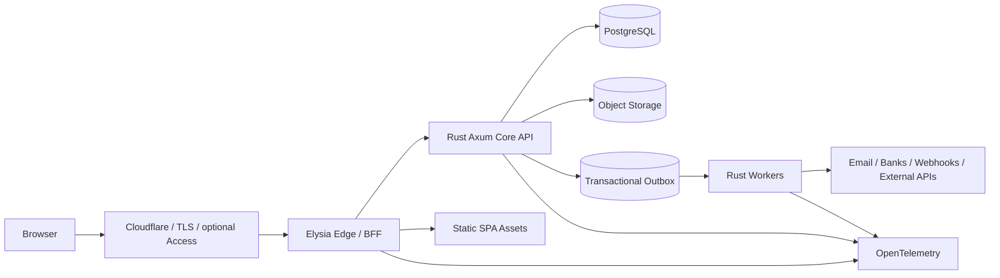

There is an important refinement for the **Community edition**: I would make Elysia an **optional runtime component**, not a mandatory dependency. Bun can build the frontend at release time and Rust can serve the compiled static assets. That lets a Community user self-host Haruflow with roughly:

```text
haruflow-core
postgres
```

instead of:

```text
haruflow-edge
haruflow-core
haruflow-worker
postgres
redis
reverse-proxy
...
```

Enterprise can enable the Elysia edge because **Haruflow controls the infrastructure**.

For tenancy, your earlier instinct is sound: **start Enterprise with isolated tenants** rather than a giant shared database. Every customer gets a standardized deployment, separate database credentials, separate object-storage scope, separate backups, and ideally a separate database. The fleet can share a control plane, observability system, container registry, deployment pipeline, and perhaps physical database infrastructure later, but customer business data should initially remain strongly isolated. PostgreSQL also supports row-level security with default-deny behavior when policies are enabled, which is useful as defense in depth if Haruflow eventually introduces shared-database tenancy. citeturn11view0

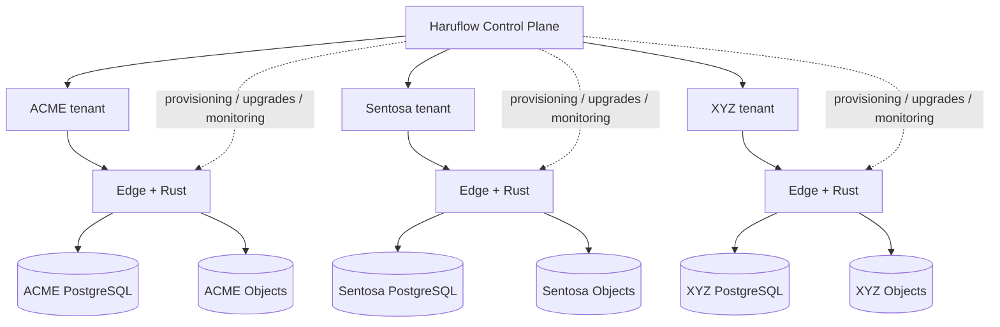

I **do not recommend microservices for Haruflow initially**. Build a modular monolith in Rust. Accounting, inventory, purchasing, sales, approvals, RBAC and integrations should be modules inside one deployable core binary, with workers as a second executable/process from the same codebase. Microservices would create distributed transactions, service discovery, schema/API versioning, observability and deployment problems that provide little benefit to a solo founder.

I also **do not recommend Kubernetes initially**. Kubernetes is excellent at declaratively managing containerized workloads, Deployments and scaling, but that capability carries an operational surface you do not need while Haruflow has a small fleet. citeturn22search0turn22search16 Start Enterprise with reproducible VM/container templates and graduate to Kubernetes when fleet management—not raw application performance—actually becomes painful.

The stack I would commit to is:

| Layer | Recommendation | Role |
|---|---|---|
| Browser application | TypeScript SPA, built by Bun | ERP UI |
| JS toolchain | **Bun** | install, test, build, workspaces |
| Edge/BFF | **Elysia**, optional/thin | proxy, aggregation, realtime, plugin adapters |
| Core backend | **Rust + Axum** | all authoritative business logic |
| Async runtime | **Tokio** | networking, tasks, timers |
| Middleware | **Tower / tower-http** | tracing, timeouts, CORS, limits |
| Data access | **SQLx** | SQL, transactions, pool, migrations |
| Primary DB | **PostgreSQL** | ERP transactional source of truth |
| Jobs | PostgreSQL-backed queue first | reports, webhooks, integrations |
| Files | S3-compatible object storage | attachments, exports, documents |
| Identity | OIDC first; SAML through broker | Enterprise SSO |
| Observability | OpenTelemetry + structured tracing | logs, metrics, traces |
| Community deployment | Docker Compose | DIY self-hosted |
| Enterprise initial deployment | isolated containerized tenant | Haruflow-managed |
| Enterprise later | Kubernetes if justified | fleet orchestration |
| Network perimeter | Cloudflare optional | DNS, proxy, Tunnel, Access |

That architecture is optimized less for theoretical requests per second and more for the thing that matters most in your situation:

**How much reliable ERP can one founder safely operate?**

## Requirements and performance envelope

Haruflow is an ERP, so optimizing solely for HTTP throughput would be the wrong target. Most meaningful requests eventually touch PostgreSQL, evaluate permissions, validate business rules, lock or update rows, generate audit records, and perhaps schedule downstream work. Rust frameworks can process HTTP considerably faster than the actual ERP transaction path is likely to require; database design, transaction boundaries, indexes, reports and external integrations are therefore more likely to determine real-world latency. This is an architectural inference rather than a claim from a synthetic benchmark.

**There is currently no user-specified RPS requirement, database-connection limit, concurrency target, or contractual latency SLO for Haruflow.** Therefore the numbers below should be treated as *initial engineering budgets*, not promises to customers.

A reasonable planning envelope is:

| Metric | Initial engineering target | Interpretation |
|---|---:|---|
| Interactive API read P95 | <250–300 ms | Excludes large reports/files |
| Transactional write P95 | <400–500 ms | In-region client |
| Ordinary request P99 | <1 s | Excludes third-party API waits |
| Synchronous report | <2 s | Otherwise make it async |
| Small tenant burst | ~100 req/s | Capacity target, not user limit |
| Medium tenant burst | ~300 req/s | Load-test before selling an SLA |
| Large tenant burst | ~1,000 req/s | Requires real workload testing |
| Small app DB pool | ~10 connections | Starting budget |
| Medium app DB pool | ~20 | Starting budget |
| Large app DB pool | ~40 per deployment | Tune against DB capacity |
| Background-worker pool | ~3–10 | Independent of HTTP pool |

These values deliberately leave enormous headroom relative to ordinary human-driven ERP activity. A cashier or finance officer does not create hundreds of POST requests per second individually; bursts are more likely to come from imports, reporting, integrations, automation or badly behaved clients.

**Concurrency nevertheless matters.** Inventory reservations, numbering/sequencing, payments, journal posting and approval transitions can collide even at modest request rates. PostgreSQL transactions provide all-or-nothing behavior and hide intermediate transaction state from other transactions. PostgreSQL's default `READ COMMITTED` isolation is useful for ordinary workflows, while stronger `REPEATABLE READ` and `SERIALIZABLE` semantics are available for flows that require them. citeturn1search3turn11view1

The correct model is therefore not:

```text
"Rust is fast, so race conditions won't happen."
```

It is:

```text
HTTP concurrency
       ↓
business invariants
       ↓
transaction
       ↓
database constraints + appropriate locking/isolation
       ↓
commit
```

For critical ERP operations, I would establish these rules:

| Business operation | Recommended consistency strategy |
|---|---|
| Create quotation/draft | Normal transaction |
| Confirm sales order | Transaction + invariant checks |
| Reserve finite inventory | Transaction + row locking/version check |
| Post inventory movement | Atomic ledger + balance update |
| Post accounting journal | Atomic, immutable posting |
| Register payment | Atomic payment + journal relationship |
| Period close | Explicit locking/workflow state |
| External webhook | Idempotency key + transaction |
| Send webhook/email | Transactional outbox, asynchronous delivery |
| Generate large report | Background job against stable query boundary |

Do **not** use `SERIALIZABLE` everywhere simply because it sounds safer. Use database constraints, version columns, `SELECT ... FOR UPDATE`/appropriate locking and application-level retries, and reserve serializable transactions for business flows where serialization anomalies genuinely matter. PostgreSQL documents `SERIALIZABLE` as its strictest isolation level and explicitly exposes the weaker levels for different concurrency trade-offs. citeturn11view1

For accounting, Haruflow should strongly prefer a **ledger model**. Once a journal is posted, corrections should normally be represented by reversals/adjusting entries rather than silently rewriting history. Inventory benefits from a similar movement-ledger approach. This simultaneously improves auditability, reconciliation and debugging.

Reporting should start inside PostgreSQL rather than prematurely building a warehouse. Use carefully indexed reporting queries, summary/materialized tables where needed, and asynchronous exports. If large reports later interfere with OLTP, the progression should be:

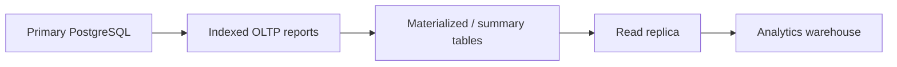

Do not jump directly to Kafka + ClickHouse + warehouse pipelines for an ERP that does not yet have customers generating enough workload to justify them.

File handling should likewise stay outside the transactional database. Store invoice attachments, scanned documents, generated PDFs and exports in **object storage**, while PostgreSQL contains only metadata such as tenant, object key, MIME type, size, checksum, uploader and access policy. AWS's current Lightsail pricing illustrates why object storage is operationally attractive: its published bundles include 100 GB for $3/month and 250 GB for $5/month before overage, although actual Haruflow Enterprise deployments may use S3 or another provider rather than Lightsail storage. citeturn23view1

A safe upload flow is:

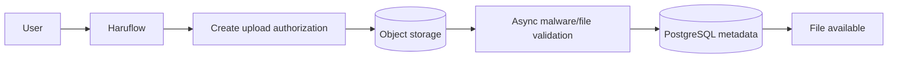

The application should validate filename, size and media type, generate its own storage keys, checksum the object, and avoid trusting user-supplied paths. Large file contents should not flow through Rust memory if a signed/direct-upload mechanism is available.

Integrations need to assume third parties fail. A purchase order transaction should **not** become invalid because an email service is down:

```text
BEGIN
  write PO
  write audit event
  write outbox event
COMMIT

worker later:
  outbox event → email/webhook/external system
```

This “commit first, deliver asynchronously” pattern is one of the most important architectural choices for Haruflow.

## Technology evaluation and recommended stack

Rust itself is a defensible choice for a long-lived ERP core. The Rust project describes its ownership/type model as providing memory and thread safety and emphasizes predictable performance without a garbage collector. citeturn19search2 The disadvantage is developer velocity: a solo developer unfamiliar with Rust may implement the first 20% slower than with TypeScript or Go. That cost is real and should not be hidden by benchmark enthusiasm.

Among Rust web frameworks, **Axum is the best default for Haruflow** because it fits directly into Tokio and Tower. Axum emphasizes ergonomic routing, extractors and modularity rather than maintaining a parallel middleware ecosystem. citeturn7search2turn7search6 Tokio supplies the async runtime, I/O, scheduling, timers and networking primitives, and its ecosystem includes Hyper, Tonic, Tower and `tracing`. citeturn4search0turn4search14

The framework comparison is:

| Option | Maturity / ecosystem | Performance | Developer productivity | Operational complexity | Haruflow verdict |
|---|---|---|---|---|---|
| **Axum** | High; deeply aligned with Tokio/Tower. citeturn7search2turn4search0 | Excellent for this workload | High after Rust learning curve | Low–medium | **Recommended** |
| **Actix Web** | High; established, type-safe and feature-rich, including HTTP/2 and TLS options. citeturn19search1turn19search21 | Excellent | High | Low–medium | Excellent alternative |
| **Poem** | Good feature breadth; official feature set includes TLS, OpenTelemetry, Prometheus, WebSocket, SSE, multipart and Tower compatibility. citeturn6view0 | Excellent enough | Very high/batteries-included | Low–medium | Strong, but smaller ecosystem |
| **Rocket** | Mature developer-focused framework with typed request/route abstractions. citeturn0search3turn0search11 | More than sufficient | Very high | Low | Viable, not my first pick |
| **Tide** | Official docs currently expose Tide 0.16 and an `async-std`-centric model. citeturn6view1 | Sufficient | Simple | Low | **Do not choose for a new 2026 core** |
| **Elysia/Bun** | Rapidly developing TS/Bun ecosystem; Elysia 2 is currently advertised as beta. citeturn2search1turn2search21 | Very fast vendor-reported HTTP characteristics | Excellent for TypeScript | Low alone; higher when paired with Rust | Edge/BFF, not ERP core |

I would not make a framework decision based on a “framework X does N million requests/second” chart. Those tests measure an increasingly tiny fraction of the path once Haruflow performs authorization, SQL, locks, serialization and audit writes. Bun itself publishes impressive WebSocket/HTTP performance information, but those are vendor benchmarks and should be treated as directional rather than an independent basis for architecture selection. citeturn2search0turn2search8

One genuine Axum trade-off is that Tower's powerful generic middleware types can become intimidating when middleware stacks get complicated; this is visible even in discussions around the Axum ecosystem. That complexity is manageable if Haruflow keeps middleware conventional rather than building elaborate custom type towers.

For the runtime, use **Tokio**, not multiple async ecosystems. Tokio provides multi-threaded runtime scheduling, network/I/O primitives and a large surrounding ecosystem, while its documentation also emphasizes bounded concurrency and backpressure rather than spawning unbounded work. citeturn4search7turn4search11turn4search26

The Rust dependency direction should look approximately like:

```text
axum
tokio
tower / tower-http
serde
sqlx
tracing
opentelemetry
openidconnect
object-storage adapter
job/outbox module
```

For persistence, **SQLx wins over Diesel for Haruflow**.

SQLx is async-first, supports Tokio, includes asynchronous connection pools and migrations, and provides compile-time checked query macros while remaining close to actual SQL. That is particularly attractive for ERP systems because reporting, financial queries and inventory reconciliation eventually require explicit SQL rather than only CRUD-style ORM operations. citeturn6view2

| Data layer | Strength | Weakness | Recommendation |
|---|---|---|---|
| **SQLx** | Explicit SQL, async-native, compile-time checked query macros, built-in pool/migrations. citeturn6view2 | More SQL to write manually | **Use** |
| **Diesel** | Strong schema/query DSL and type-driven ORM approach. citeturn6view3 | More abstraction when complex ERP SQL inevitably appears | Good alternative, not preferred |
| Hand-written driver only | Maximum control | Reinvents migrations/pool ergonomics | No |
| Full repository abstraction hiding SQL | Looks clean initially | Often obstructs reporting/query optimization | Avoid excessive abstraction |

Do not build a “database agnostic” ERP persistence abstraction that pretends PostgreSQL, MySQL and SQLite behave identically. Haruflow should deliberately use PostgreSQL's strengths.

Use SQLx's built-in pool first. Do not introduce another pool library unless there is an identified problem. Most importantly, **bound the pools**. If 50 tenant application replicas each independently open 30 database connections against one PostgreSQL server, “fast Rust” has simply created 1,500 database sessions.

A reasonable rule is:

```text
sum(all app pool maxima)
+ sum(worker pool maxima)
+ admin/migration allowance
< safe PostgreSQL connection budget
```

When the Enterprise architecture eventually consolidates many databases onto shared PostgreSQL clusters, add **PgBouncer** or an equivalent connection proxy before increasing PostgreSQL's connection count indefinitely.

For background work, two Rust options are particularly relevant. Apalis provides a multithreaded job-processing model with Tokio support, Tower integration, tracing/Prometheus support, retry and timeout facilities. Fang provides PostgreSQL, SQLite and MySQL-backed tasks, asynchronous Tokio workers, scheduling and retry/backoff. citeturn9view0turn9view1

For a solo founder, I would start even simpler:

```text
PostgreSQL
├── business tables
├── outbox_events
└── background_jobs
          │
          ▼
    Rust worker process
```

Then graduate to Fang or Apalis when scheduling/retry complexity warrants a formal framework. This deliberately avoids Redis on day one.

### Where Bun and Elysia should sit

Bun is more than adequate as the JavaScript runtime/toolchain. Its documentation describes an integrated runtime, package manager, bundler and test runner; it supports workspaces and Docker deployment. citeturn2search0turn2search6turn2search15

But **Bun is not the browser UI framework**, and **Elysia is not the frontend UI framework**.

A clean separation is:

```text
Bun
├── package manager
├── test runner
├── build/bundle
└── runtime for Elysia

Elysia
├── BFF / aggregation
├── static assets if desired
├── optional SSR
├── WebSocket edge
├── plugin/webhook facade
└── reverse proxy to Rust

Browser UI
└── React/Svelte/Vue/etc.

Rust
└── authoritative ERP API
```

For an authenticated ERP, I would actually default to a **client-side application rather than extensive SSR**. Search-engine indexing provides almost no value inside an authenticated finance/inventory system, while SSR introduces another execution path that has to handle authentication, caching and failures. Keep the public `haruflow.com` marketing website independent from the tenant ERP application.

Elysia should **never directly mutate ERP database tables**. That rule keeps the architecture understandable:

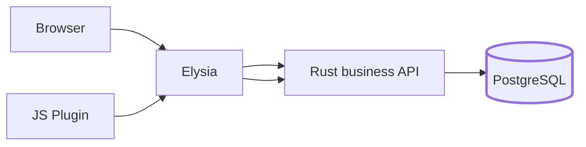

Not:

```text
Elysia ─┬─→ PostgreSQL
        │
Rust ───┘

"Which service actually owns invoice invariants?"
```

This also avoids implementing RBAC twice.

The preferred service protocol is **HTTP + JSON + OpenAPI**. It is debuggable with ordinary tools, works naturally from Bun and Rust, supports external integrations, and is entirely adequate for ERP traffic.

| Protocol | Use in Haruflow | Verdict |
|---|---|---|
| HTTP/JSON + OpenAPI | Browser/BFF → Rust; external API | **Default** |
| gRPC | Internal high-volume service boundaries later | Good, but premature now |
| GraphQL | Highly dynamic client querying | Optional, likely unnecessary |
| JSON-RPC | Command-oriented internal APIs | Little benefit here |
| WebSocket | realtime notification/presence/status | Selective use |
| SSE | one-way live notifications/progress | Often simpler than WebSocket |

Tokio's broader ecosystem includes Tonic for gRPC, so adding gRPC later does not require changing the runtime. citeturn4search0 Elysia's plugin ecosystem also exposes GraphQL integrations if a real use case eventually appears. citeturn3search7

For realtime behavior, avoid turning ordinary ERP CRUD into socket-only APIs. Use normal HTTP transactions and then deliver events separately:

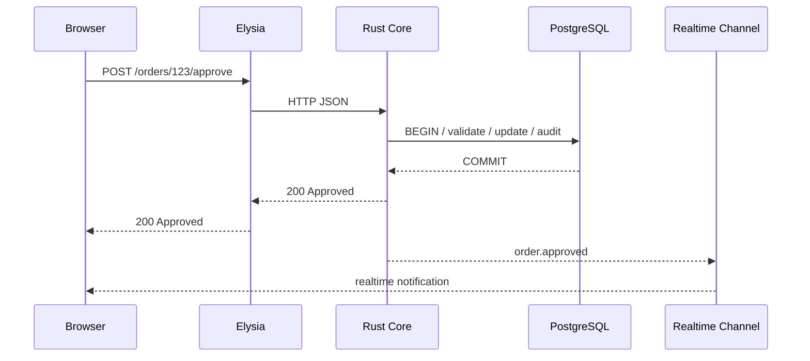

Bun has native WebSocket support with server-side pub/sub and backpressure-related facilities, making Elysia/Bun a reasonable realtime edge if that role becomes substantial. citeturn2search8

Finally, **do not use WASM as the Rust↔Elysia communication mechanism**. Native processes speaking localhost/private HTTP are easier to profile, patch and debug. WASM could eventually become interesting as a sandbox for customer-defined deterministic business rules, but that is a separate plugin architecture problem.

## Data, tenancy, security, and identity

For Haruflow Enterprise, I strongly recommend that **single-tenant isolation remain the default architecture for the first several years of the product unless economics prove otherwise**.

That does not necessarily mean “one physical server for every customer forever.” Isolation has several levels:

| Model | App compute | Database | Isolation | Cost efficiency | Operational difficulty |
|---|---|---|---|---|---|
| Fully isolated | Per tenant | Per tenant instance | Excellent | Lowest | Low initially, fleet-heavy later |
| Shared host, isolated containers | Per tenant container | Per tenant DB | Very good | Better | Medium |
| Shared app, DB-per-tenant | Shared stateless app | Separate DB per tenant | Very good | High | Medium-high |
| Shared DB, schema-per-tenant | Shared | Shared instance/schema split | Medium | Higher | High |
| Shared tables + `tenant_id` | Shared | Shared tables | Lowest logical isolation | Highest | Very high security burden |

The **first row or second row** is ideal for early Haruflow Enterprise.

A central Haruflow control plane can provision them without sitting inside the customer's data path:

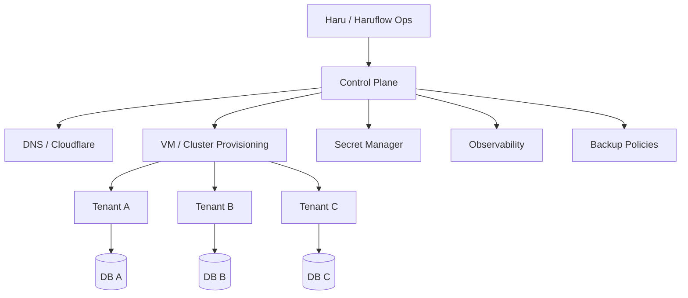

This design makes the blast radius understandable. A broken migration for ACME does not inherently mean Sentosa's database is broken. A restore can operate at tenant granularity. A large customer can be moved to larger infrastructure without redesigning the data model.

Later, when the fleet becomes large, Haruflow can consolidate without throwing away the isolation contract:

```text
Today:
VM A → DB A
VM B → DB B
VM C → DB C

Later:
Shared app cluster
    ├── DB A
    ├── DB B
    └── DB C
```

Only consider shared-table multi-tenancy when its economic benefit is meaningful enough to justify the security complexity. PostgreSQL row-level security can restrict row visibility/modification using policies, and once RLS is enabled with no applicable policy it behaves as default-deny. PostgreSQL also documents important exceptions such as table owners and privileged roles, so RLS should be defense in depth rather than the only tenant boundary. citeturn11view0

### RBAC and organizational scope

Haruflow's authorization model should not stop at:

```text
Admin
User
```

ERP access normally varies across company, branch, warehouse and function. Model it roughly as:

```text
Principal
   ↓
Membership
   ↓
Role
   ↓
Permission
   ↓
Scope
├── organization
├── company
├── branch
├── warehouse
└── resource
```

An actual check might therefore be:

```text
user = Budi
permission = inventory.adjust
company = PT ACME
warehouse = Surabaya-01
```

The Rust core must perform this authorization **at every authoritative endpoint**. Cloudflare Access, Elysia middleware and UI buttons may provide additional restrictions, but none should substitute for backend authorization.

Keep authorization denormalized enough that ordinary requests do not require twenty joins. Cache effective grants carefully, and invalidate the cache whenever membership/role definitions change.

### SSO

Implement **OpenID Connect first**. The Rust `openidconnect` ecosystem provides typed OIDC/OAuth interfaces, authorization-code flows and PKCE support, and its documentation contains explicit security guidance around HTTP redirects and SSRF. citeturn9view2

Direct SAML implementation is less attractive. The Rust Samael project exists, but its currently published crate is still in the `0.0.x` series, which is a poor foundation on which to make a solo founder responsible for every variation of enterprise SAML federation. citeturn9view3

Instead:

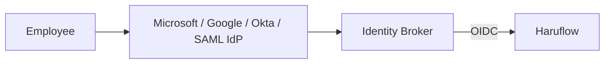

Keycloak, for example, supports OIDC application integration and SAML identity-provider integration, making it possible to expose one OIDC-shaped interface to Haruflow while brokering enterprise SAML outside the application. citeturn9view4turn9view5 A managed identity provider can perform the same role if you do not want to operate Keycloak.

Cloudflare Access can provide another outer layer. Cloudflare currently documents Access applications as **deny by default** until a user matches an Allow policy and supports numerous OIDC/SAML identity providers. citeturn18view2turn18view3

I would use it like this:

```text
Optional perimeter:
Cloudflare Access
       ↓
Haruflow authentication / OIDC
       ↓
Haruflow RBAC
       ↓
ERP data
```

Access is particularly useful around your **Haruflow admin/control plane**. For customer ERP applications, make it optional because some customers will want Haruflow's own SSO/login flow without a second Cloudflare gate.

### Security baseline

Use OWASP ASVS as a concrete application-security checklist. The current ASVS project describes itself as a standard for verifying web-application technical security controls and currently exposes ASVS 5.0 as the latest stable version. citeturn15search18

For Haruflow I would define mandatory controls around:

| Area | Required design |
|---|---|
| Transport | TLS everywhere externally |
| Database | private networking; TLS where crossing network boundaries |
| Secrets | secret manager / mounted secrets, never repository/env templates with real credentials |
| Passwords | slow password hashing; MFA option |
| Sessions | opaque secure HttpOnly cookies; expiry/revocation |
| CSRF | protection on cookie-authenticated state-changing operations |
| RBAC | deny by default |
| Tenant isolation | DB/credential/storage separation |
| SQL | bound parameters / SQLx queries |
| Files | object isolation, signed access, validation/scanning |
| Audit | immutable-style append events |
| API abuse | request limits and rate controls |
| Integrations | scoped credentials, retries, idempotency |
| Admin access | MFA and stronger perimeter |
| Supply chain | locked dependencies, SBOM/scanning |
| Backups | encrypted, off-host and restoration-tested |

An audit event should be a first-class domain artifact:

```json
{
  "tenant_id": "t_acme",
  "actor_id": "u_123",
  "action": "purchase_order.approved",
  "resource_type": "purchase_order",
  "resource_id": "PO-2026-00128",
  "timestamp": "...",
  "request_id": "...",
  "source_ip": "...",
  "before_hash": "...",
  "after_hash": "..."
}
```

Do not log passwords, tokens, full session cookies or arbitrary request bodies into audit records.

### Backups and recovery

PostgreSQL's write-ahead log architecture supports continuous archiving and point-in-time recovery; the official PostgreSQL documentation also describes using archived WAL for recovery and standby scenarios. citeturn10search7turn10search8

A serious Enterprise policy should therefore progress toward:

```text
Primary DB
   │
   ├── continuous WAL/PITR
   ├── scheduled base backup
   ├── encrypted backup destination
   └── periodic restore test
```

A backup that has never been restored is not sufficient evidence that recovery works.

Since Haruflow has no customer SLA yet, no actual RPO/RTO requirement exists. A useful initial *internal target* would be approximately:

| Target | Initial planning objective |
|---|---|
| RPO | ≤15–60 minutes for Enterprise |
| RTO | ≤4 hours for ordinary tenant incident |
| Backup verification | daily automated checks |
| Restore drill | at least periodically and before claiming strong SLA |

Those are proposed engineering targets, not contractual promises.

Finally, “encrypted database” is not itself “compliance.” SOC 2, ISO 27001, Indonesian privacy requirements, GDPR or sector-specific obligations also involve organizational processes, access review, incident management, vendor governance, retention and evidence. Architecture can make those certifications easier; it does not automatically confer them.

## Deployment, operations, observability, and cost

Haruflow's two editions should intentionally have **different operational contracts**.

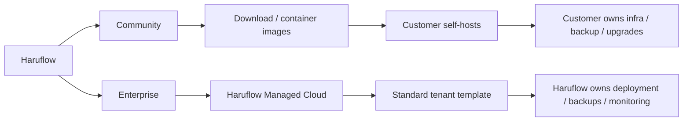

Community should be as boring as possible operationally. Provide images, a Compose template, migration commands and documentation. **Do not create a Community cloud service.** If users choose exotic NAS devices, reverse proxies, database settings or private networks, that remains their infrastructure.

Enterprise is the opposite: standardization is the product.

A tenant provisioning workflow should eventually be one command or control-plane action:

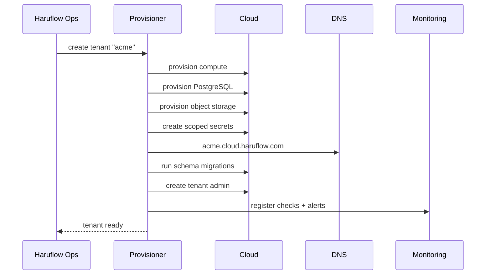

### Cloudflare Tunnel

Cloudflare Tunnel is useful but should remain **an adapter, not an architectural dependency**.

Cloudflare documents that `cloudflared` can establish outbound-only connections to its network, allowing the origin to operate without a publicly routable IP and allowing the firewall to block inbound traffic to the origin. citeturn18view0turn18view1

That lets an Enterprise tenant look like:

```text
acme.cloud.haruflow.com
          │
     Cloudflare
          │
    outbound Tunnel
          │
     private VM
     ├─ Elysia
     ├─ Rust
     └─ worker
```

This is appealing for a solo operator because you do not have to manage Internet-exposed origin ports for every VM. But keep a conventional ingress option so Haruflow could move to another CDN/network provider later.

### Observability

Rust has a strong fit here through `tracing`, which provides structured, event-oriented diagnostics, while Elysia has an official OpenTelemetry plugin. citeturn4search30turn3search1

All three execution surfaces should emit correlated telemetry:

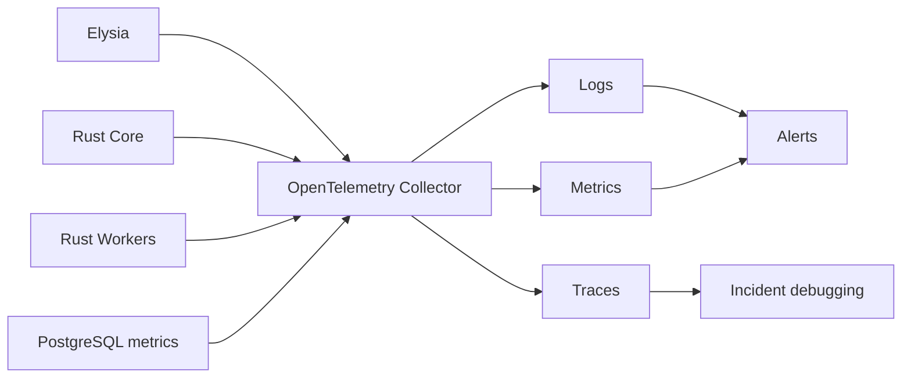

Every request should carry a generated `request_id`/trace context through:

```text
Browser
  → Cloudflare
    → Elysia
      → Rust
        → PostgreSQL
        → worker/outbox
```

Telemetry should attach an opaque tenant identifier but avoid attaching invoice content, customer names, passwords, payroll values or full document bodies.

At minimum monitor:

| Layer | High-value signals |
|---|---|
| HTTP | request rate, P50/P95/P99 latency, 4xx, 5xx |
| Rust | panic count, task saturation, memory/CPU |
| Elysia | event-loop/runtime health, 5xx, socket counts |
| PostgreSQL | active connections, locks, slow queries, storage, replication/PITR |
| Jobs | queue depth, age of oldest job, retry count |
| Integrations | timeout/failure rate by provider |
| Files | storage usage, scanning failures |
| Backups | most recent successful backup/WAL archive |
| Tenant | availability and synthetic login/API check |
| Security | failed auth, privilege changes, abnormal API patterns |

Do not alert on everything. Alert when a human may need to act. A 70% CPU reading for two minutes is telemetry; “database storage will fill in six hours” is an alert.

### CI/CD and infrastructure automation

The pipeline should build **immutable artifacts once**, then promote the same images.


For Rust:

```text
cargo fmt --check
cargo clippy
cargo test
SQL integration tests
dependency/security checks
release build
container build
```

For Bun/Elysia:

```text
bun install --frozen-lockfile
typecheck
tests
bundle/build
container build
```

Run schema migrations as a controlled deployment step rather than automatically from every application replica. Use **expand-and-contract migrations**:

```text
release A:
add new nullable column/table
old + new code both work

release B:
switch application to new representation

release C:
remove obsolete representation
```

This matters when you have dozens of customer instances on slightly different deployment timestamps.

Infrastructure definitions should produce the same tenant repeatedly from parameters:

```text
tenant_id
region
app_size
db_size
domain
storage_quota
backup_policy
feature_tier
```

I would use declarative infrastructure tooling plus a small Haruflow provisioning layer; the particular Terraform/OpenTofu choice matters less than the rule that production infrastructure must not live only as commands in your shell history.

Kubernetes should be **the second-generation Enterprise platform**, not the first. Kubernetes Deployments are designed to declaratively manage stateless application Pods and controlled updates, while Kubernetes also has dedicated configuration/secret facilities. citeturn22search0turn22search13

Even after adopting Kubernetes, I would keep production PostgreSQL **outside the cluster as a managed/stateful service** initially. Your competitive advantage is ERP software, not becoming a PostgreSQL Kubernetes operator.

### Cost model

The following is a **capacity-planning estimate, not a cloud-provider quotation**. Exact costs depend on region, architecture, traffic, backups, support level and provider discounts. AWS, GCP and Azure all expose configurable pricing, so exact purchasing decisions should be run through their current calculators; I use AWS Lightsail here because its published monthly bundles make the assumptions easy to audit rather than pretending dissimilar VM families are exactly comparable. citeturn14view2turn14view3turn21view0

AWS currently lists, among other options, IPv6-only Linux bundles at roughly $20/month for 4 GB RAM, $40 for 8 GB and $80 for 16 GB. Its Lightsail managed-database pricing lists an encrypted 2 GB database at $30/month, encrypted 4 GB at $60, and an 8 GB database at $115 standard/$230 high availability. It also lists 100 GB object storage at $3/month. Jakarta-region transfer allowances are half the headline bundle allowances. citeturn21view0turn23view1

Notably, Lightsail's published 1 GB database tier is listed without data encryption, while the 2 GB-and-up tiers are marked encrypted, so I would not select the smallest tier for Enterprise simply to save $15. citeturn23view1

Using those current prices as a lower-bound anchor:

| Tenant profile | Illustrative architecture | Raw infra planning band / month | Operational reserve |
|---|---|---:|---:|
| **Small** | 4 GB app + 2 GB encrypted DB + object storage + backups | **$60–100** | ~1–2 founder hours/month |
| **Medium** | 8 GB app + 4–8 GB DB + more storage/backups | **$120–250** | ~2–5 hours/month |
| **Large** | 2+ app nodes + HA DB + LB/storage/monitoring | **$450–1,500+** | ~5–15+ hours/month |

The small reference point can be understood as roughly:

```text
4 GB compute             ~$20+
2 GB encrypted DB        ~$30
100 GB object storage     ~$3
snapshots/backups/logs     extra
--------------------------------
baseline                  ~$53+
realistic planning        ~$60–100
```

The large profile rises quickly because availability costs money. Lightsail currently prices its 8 GB database at $230/month in HA configuration and its load balancer at $18/month before application replicas, backup storage, observability or egress. citeturn23view1

The crucial business implication is that a Haruflow Enterprise subscription of, for example, several million rupiah per company per month **can have healthy infrastructure gross margin for an ordinary tenant**, provided you do not promise unlimited compute/storage/API traffic. A $60–150 infrastructure bill is not the main threat.

The threat is this:

```text
one unusual client
+ giant imports
+ 800 GB attachments
+ bad reports
+ custom integrations
+ support incidents
+ repeated manual deployment work
= founder time becomes the real COGS
```

Therefore Enterprise plans should have explicit resource envelopes for storage, extraordinary workloads and perhaps user/activity scale, even if the marketing model remains “per company” rather than “per seat.”

Also separate **software/application availability** from **service labor**. Implementation, migration, custom reports, custom connectors and highly bespoke workflows should not be hidden inside a low recurring cloud fee.

## Deployment templates and integration patterns

The templates below deliberately show the architecture rather than every production hardening detail.

For an isolated Community or simple single-tenant installation, Docker Compose can remain understandable:

```yaml
# compose.yaml
services:
  postgres:
    image: postgres:18-alpine
    restart: unless-stopped
    environment:
      POSTGRES_DB: haruflow
      POSTGRES_USER: haruflow
      POSTGRES_PASSWORD_FILE: /run/secrets/db_password
    secrets:
      - db_password
    volumes:
      - postgres_data:/var/lib/postgresql/data
    healthcheck:
      test: ["CMD-SHELL", "pg_isready -U haruflow -d haruflow"]
      interval: 10s
      timeout: 5s
      retries: 5
    networks:
      - internal

  core:
    image: ghcr.io/haruflow/core:${HARUFLOW_VERSION:-latest}
    restart: unless-stopped
    depends_on:
      postgres:
        condition: service_healthy
    environment:
      HARUFLOW_BIND: "0.0.0.0:8080"
      DATABASE_HOST: postgres
      DATABASE_NAME: haruflow
      DATABASE_USER: haruflow
      DATABASE_PASSWORD_FILE: /run/secrets/db_password
      STORAGE_BACKEND: local
      STORAGE_PATH: /data/uploads
      RUST_LOG: info
    secrets:
      - db_password
    volumes:
      - uploads:/data/uploads
    networks:
      - internal

  worker:
    image: ghcr.io/haruflow/core:${HARUFLOW_VERSION:-latest}
    command: ["haruflow", "worker"]
    restart: unless-stopped
    depends_on:
      postgres:
        condition: service_healthy
    environment:
      DATABASE_HOST: postgres
      DATABASE_NAME: haruflow
      DATABASE_USER: haruflow
      DATABASE_PASSWORD_FILE: /run/secrets/db_password
    secrets:
      - db_password
    networks:
      - internal

  edge:
    image: ghcr.io/haruflow/edge:${HARUFLOW_VERSION:-latest}
    restart: unless-stopped
    environment:
      CORE_URL: http://core:8080
    depends_on:
      - core
    ports:
      - "3000:3000"
    networks:
      - internal

  cloudflared:
    image: cloudflare/cloudflared:latest
    command: tunnel --no-autoupdate run
    restart: unless-stopped
    profiles: ["tunnel"]
    environment:
      TUNNEL_TOKEN_FILE: /run/secrets/cloudflare_tunnel_token
    secrets:
      - cloudflare_tunnel_token
    networks:
      - internal

secrets:
  db_password:
    file: ./secrets/db_password
  cloudflare_tunnel_token:
    file: ./secrets/cloudflare_tunnel_token

volumes:
  postgres_data:
  uploads:

networks:
  internal:
```

Cloudflare's Tunnel architecture supports exactly the optional pattern shown here: `cloudflared` initiates outbound connections, so a production origin can avoid a publicly routable address or open inbound origin port. citeturn18view0

For **Community**, I would go one step further in release engineering. Have Bun compile the web UI into static artifacts during the build:

```text
bun build
   ↓
dist/
   ↓
embedded/copied into Rust image
   ↓
Axum serves UI + API
```

Then `edge` can be removed from the default Community Compose template entirely.

That gives Community users:

```text
Browser
   ↓
Rust/Axum
   ├─ static frontend
   ├─ ERP API
   └─ PostgreSQL
```

while your Enterprise deployment can remain:

```text
Browser
   ↓
Cloudflare
   ↓
Elysia Edge
   ↓
Rust Core
```

This asymmetry is acceptable because the same API and frontend code still exist; Enterprise simply enables a richer edge layer.

For a later managed-cloud Kubernetes template, keep tenant application isolation while putting state in managed services:

```yaml
apiVersion: v1
kind: Namespace
metadata:
  name: haruflow-acme
---
apiVersion: v1
kind: Secret
metadata:
  name: haruflow-secrets
  namespace: haruflow-acme
type: Opaque
stringData:
  # Illustrative only. Production values should come from
  # an external secret manager/controller.
  database-url: "<managed-postgres-url>"
  oidc-client-secret: "<secret>"
---
apiVersion: v1
kind: ConfigMap
metadata:
  name: haruflow-config
  namespace: haruflow-acme
data:
  TENANT_ID: "acme"
  CORE_URL: "http://127.0.0.1:8080"
  STORAGE_BACKEND: "s3"
---
apiVersion: apps/v1
kind: Deployment
metadata:
  name: haruflow-web
  namespace: haruflow-acme
spec:
  replicas: 2
  selector:
    matchLabels:
      app: haruflow-web
  template:
    metadata:
      labels:
        app: haruflow-web
    spec:
      containers:
        - name: core
          image: ghcr.io/haruflow/core:1.0.0
          ports:
            - containerPort: 8080
          envFrom:
            - configMapRef:
                name: haruflow-config
          env:
            - name: DATABASE_URL
              valueFrom:
                secretKeyRef:
                  name: haruflow-secrets
                  key: database-url
          readinessProbe:
            httpGet:
              path: /health/ready
              port: 8080
          resources:
            requests:
              cpu: "250m"
              memory: "256Mi"

        - name: edge
          image: ghcr.io/haruflow/edge:1.0.0
          ports:
            - containerPort: 3000
          envFrom:
            - configMapRef:
                name: haruflow-config
          readinessProbe:
            httpGet:
              path: /health
              port: 3000

---
apiVersion: v1
kind: Service
metadata:
  name: haruflow-web
  namespace: haruflow-acme
spec:
  selector:
    app: haruflow-web
  ports:
    - port: 80
      targetPort: 3000

---
apiVersion: apps/v1
kind: Deployment
metadata:
  name: haruflow-worker
  namespace: haruflow-acme
spec:
  replicas: 1
  selector:
    matchLabels:
      app: haruflow-worker
  template:
    metadata:
      labels:
        app: haruflow-worker
    spec:
      containers:
        - name: worker
          image: ghcr.io/haruflow/core:1.0.0
          args: ["haruflow", "worker"]
          envFrom:
            - configMapRef:
                name: haruflow-config
          env:
            - name: DATABASE_URL
              valueFrom:
                secretKeyRef:
                  name: haruflow-secrets
                  key: database-url
```

Kubernetes Deployments are intended for stateless workloads and declarative rollout management, which maps naturally to Rust/Elysia and worker containers. citeturn22search0 Database state remains outside the Deployment.

The same tenant manifest should be generated from one template:

```text
haruflow-tenant-template
        │
        ├── tenant = acme
        │   ├── CPU = small
        │   ├── DB = medium
        │   └── storage = 100GB
        │
        └── tenant = bigcorp
            ├── CPU = large
            ├── DB = HA
            └── storage = 1TB
```

That is much safer than manually maintaining 100 slightly different Compose files.

### Rust/Elysia trust boundary

The internal API should be private:

```text
Internet
   │
   ▼
Elysia :3000
   │
   │ private localhost/service network
   ▼
Rust :8080
   │
   ▼
PostgreSQL
```

Elysia should strip any externally supplied internal headers before proxying. Rust should not accept something like:

```http
X-User-Is-Admin: true
```

as authorization just because the request came from Elysia.

Ideally the browser session remains authoritative in Rust:

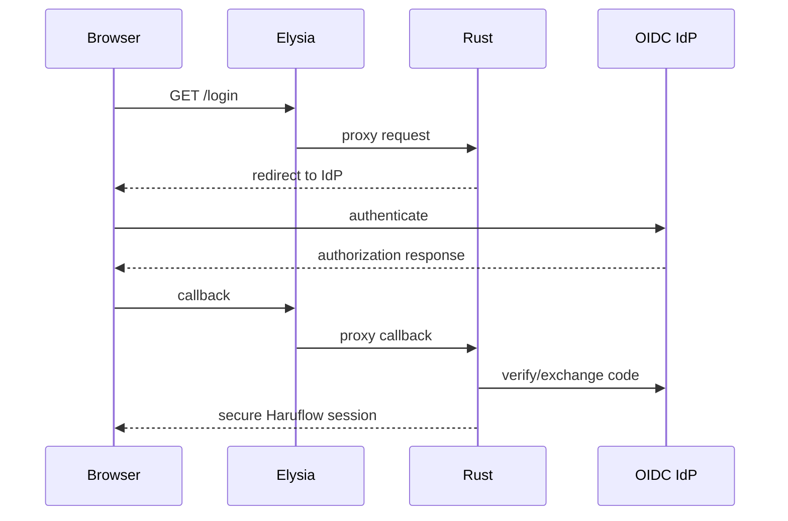

This has one major benefit: **all authentication and RBAC stays in one language/service**.

Elysia is consequently replaceable. If two years from now Bun/Elysia no longer fits, the business core remains intact.

For JavaScript plugins, introduce **capability APIs**, not database credentials:

```text
Plugin
  │
  │ scoped token:
  │ orders.read
  │ webhooks.write
  ▼
Elysia plugin gateway
  ▼
Rust capability API
  ▼
RBAC + tenant boundary
  ▼
PostgreSQL
```

That will matter enormously once Haruflow customers ask for custom integrations.

## Migration roadmap, agent guardrails, and risk register

Because the current Haruflow stack is unspecified, **there is no defensible exact migration estimate**. The safest migration plan is a strangler migration rather than “rewrite everything and switch on Friday.”

Elysia can actually help here because it can route some endpoints to the old application and others to Rust:

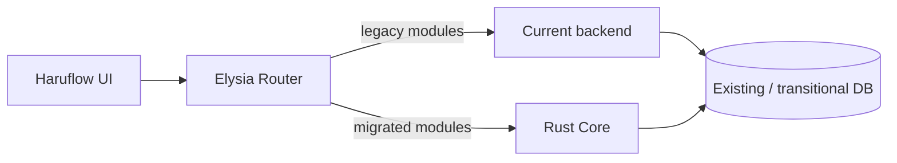

The sequence I recommend is:


A practical solo-founder implementation schedule is:

| Milestone | Scope | Solo effort |
|---|---|---:|
| Foundation | Rust workspace, Axum, Tokio, SQLx, migrations, Bun workspace, CI | **2 weeks** |
| Auth and tenancy | sessions, OIDC, tenant context, RBAC skeleton | **2–3 weeks** |
| Transaction patterns | audit log, idempotency, outbox, locking conventions | **2 weeks** |
| Edge integration | Elysia proxy/BFF, generated API client, frontend build | **1–2 weeks** |
| Jobs and files | worker, retries, object storage, upload/download | **2 weeks** |
| Core ERP vertical slice | sales → inventory → journal example | **3–4 weeks** |
| Enterprise deployment | tenant template, secrets, backup, DNS/Tunnel | **2–3 weeks** |
| Observability/security | traces, metrics, alerts, ASVS pass, restore test | **2–3 weeks** |
| Load/failure testing | pool sizing, race tests, integration failures | **1–2 weeks** |

That is roughly **17–23 developer-weeks for an Enterprise-capable technical foundation and one representative ERP vertical slice**. It is emphatically **not** an estimate for completing an entire accounting + sales + purchase + warehouse + HR + payroll ERP.

With interruptions, customer conversations and ordinary founder work, budgeting **roughly six months** for a robust foundation is more realistic than interpreting “20 developer-weeks” as 20 calendar weeks.

The migration order should deliberately put a *boring* module through Rust first—not general ledger closing. For example:

```text
master-data read/write
      ↓
simple approvals
      ↓
sales order
      ↓
inventory transaction
      ↓
purchasing
      ↓
accounting posting
```

Before migrating a financial or stock mutation, create invariant tests around the old behavior and verify Rust against the same scenarios.

For existing data, avoid prolonged dual writes. Dual writing means:

```text
old app writes old DB
new app writes new DB
hope both succeed forever
```

which creates a consistency problem worse than the migration problem.

Prefer module ownership:

```text
before cutover:
old system owns invoices

cutover:
brief migration/schema transition

after cutover:
Rust owns invoices
old endpoint becomes read-only/disabled
```

### How Dots and Codex should fit operations

OpenAI's current Dots product is explicitly an always-on agent with its own cloud computer and connected-app capabilities; OpenAI also describes Custom Rules that can allow, require approval for, or block specific actions. OpenAI states that consequential work should still be reviewed because dots can make mistakes. citeturn17view2turn18view4turn18view5

That maps unusually well to your situation—but only if Haruflow's infrastructure is designed for **safe delegation**.

OpenAI's current Codex documentation also exposes cloud environments, GitHub integration, code review, agent permissions/approvals and a dedicated Codex Security product family including cloud security review. citeturn17view3

Do not give a Dot:

```text
AWS root access
+
production DB superuser
+
kubectl cluster-admin
+
Cloudflare admin
+
GitHub owner
```

and call that automation.

Instead build machine roles:

| Capability | Agent access |
|---|---|
| Read application metrics | Automatic |
| Read sanitized logs | Automatic |
| Inspect deployment state | Automatic |
| Query backup freshness | Automatic |
| Open GitHub issue | Automatic |
| Prepare PR | Automatic |
| Run staging deployment | Automatic or limited |
| Restart one stateless worker | Pre-approved runbook |
| Scale within predefined range | Pre-approved runbook |
| Production application deployment | Approval |
| Tenant DB migration | Approval |
| Restore database | **Human approval** |
| Delete customer data | **Blocked** |
| Disable backups | **Blocked** |
| Read secrets directly | **Blocked by default** |
| Change IAM/root policy | **Blocked** |

OpenAI's own current Dot controls follow the same broad philosophy: proactive research uses restricted read-only access, Custom Rules differentiate actions that may run independently from actions requiring approval, and some sensitive actions remain with the user. citeturn18view4turn18view5

The ops loop should therefore be:

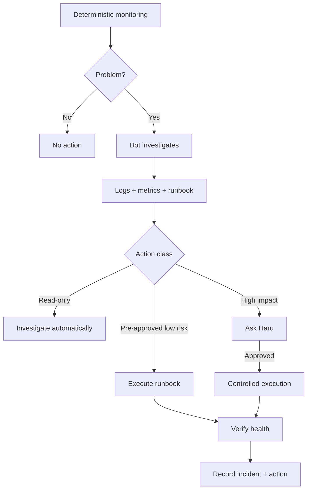

The AI should not be the thing that decides whether CPU is actually at 100%, whether a backup exists, or whether PostgreSQL replication is broken. Deterministic monitoring establishes facts. The agent interprets those facts, correlates evidence, chooses a runbook and escalates when necessary.

### Principal risks and mitigations

| Risk | Why it matters | Mitigation |
|---|---|---|
| **Two backend runtimes** | Rust + Bun doubles patching/debugging context | Keep Elysia stateless and optional |
| **Rust feature velocity** | Solo founder may ship slower initially | Modular monolith, standard crates, avoid clever abstractions |
| **Elysia API churn** | Elysia 2 is currently advertised as beta. citeturn2search21 | Pin versions; no business logic in Elysia |
| **Auth split across services** | Creates inconsistent security rules | Rust owns authentication/RBAC |
| **Tenant fleet sprawl** | 100 isolated deployments become operational work | Generate infrastructure; central control plane |
| **Shared DB migration later** | Isolation architecture may cost more | Consolidate physical infrastructure before logical data |
| **Reporting hurts OLTP** | Heavy queries can lock/use CPU | async reports, summaries, replicas later |
| **Connection explosion** | replicas × tenants × pools compound | bounded SQLx pools; PgBouncer later |
| **Custom customer forks** | upgrades become impossible | configuration, feature flags, extension APIs—not forks |
| **SAML complexity** | Enterprise implementations vary | broker SAML → OIDC |
| **Cloudflare lock-in** | networking becomes vendor-specific | keep Tunnel optional |
| **Premature Kubernetes** | founder operates platform instead of ERP | VM/Compose templates first |
| **Agent production access** | AI error can become data-loss event | read-only defaults, runbooks, approvals, audit |
| **“Fast framework” distraction** | performance work may optimize wrong layer | load-test complete transactions |
| **Backup false confidence** | backup file may be unusable | automated restore testing |

The biggest architectural risk is actually **not Rust**. Rust, Axum, Tokio, SQLx and PostgreSQL form a coherent stack. citeturn4search0turn6view2turn19search2

The bigger risk would be turning the proposed architecture into:

```text
React
  ↓
Elysia gateway
  ↓
auth microservice
  ↓
Rust sales microservice
  ↓
Rust accounting microservice
  ↓
Node integration service
  ↓
Redis
  ↓
Kafka
  ↓
Postgres cluster
  ↓
Kubernetes
  ↓
service mesh
```

before Haruflow has enough customers to require any of it.

The optimized Haruflow stack is deliberately much less exciting:

```text
                        HARUFLOW
                           │
                 TypeScript Browser UI
                     built with Bun
                           │
                           ▼
                ┌────────────────────┐
                │ Elysia Edge / BFF  │
                │ thin + replaceable │
                └─────────┬──────────┘
                          │ HTTP/JSON
                          ▼
                ┌────────────────────┐
                │ Rust / Axum Core   │
                │ modular monolith   │
                │                    │
                │ Sales              │
                │ Purchasing         │
                │ Inventory          │
                │ Accounting         │
                │ RBAC               │
                │ Audit              │
                │ Integrations       │
                └──────┬───────┬─────┘
                       │       │
                SQLx   │       │ object API
                       ▼       ▼
                PostgreSQL   Object Storage
                       │
                       ▼
                 Rust Workers
```

And the product deployment becomes equally clear:

```text
HARUFLOW COMMUNITY
────────────────────────────────
Bun-built UI
Rust/Axum application
PostgreSQL
optional object storage

Self-hosted.
User operates everything.
No Haruflow cloud.


HARUFLOW ENTERPRISE
────────────────────────────────
customer.cloud.haruflow.com
Cloudflare optional
Elysia Edge
Rust/Axum Core
Rust Worker
isolated PostgreSQL
isolated object-storage scope
central monitoring
automated backups
standardized provisioning

Haruflow operates everything.
```

That is the architecture I would choose for Haruflow as a solo founder: **Rust where correctness and long-lived business state matter, Bun where TypeScript productivity matters, Elysia where a flexible edge layer earns its existence, and PostgreSQL as the center of transactional gravity.** It gives you enough performance headroom to avoid an early rewrite while, more importantly, keeping the system simple enough that one person—assisted by disciplined automation, Codex and Dots—can plausibly operate the first meaningful fleet of Enterprise customers.